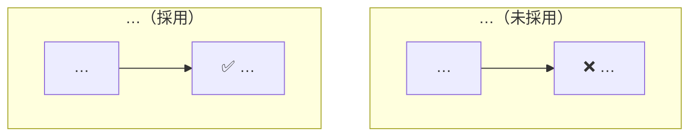

# House-style skeleton

Section order of the team's design docs. Headings are the exact strings the exemplars use; fixed opening phrases are quoted as they appear. Sections marked (optional) appear in some exemplars, not all — include one only when the topic has that concern. Fetch the live exemplars first (SKILL.md step 1); this file tells you what to look for in them, it does not replace them.

## 0. Metadata table (optional, newer docs)

| | |
|---|---|
| **狀態** | Draft — 徵求 review |
| **作者** | … |
| **最後更新** | YYYY-MM-DD |
| **背景資料** | what reviewers can open: the Slack thread, the research file's repo path, the POC — never a ticket id |

## 1. `## 一句話`

One paragraph: what the user or caller gets, and one **bold** property that defines the design (the channel is free; the backend only stores and never judges; operations fill three fields and never touch a file).
*Criterion:* no table, class, API path or service-internal name.

## 2. `## 使用者會看到什麼` ／ `## 前端會怎麼用` ／ `## 營運會怎麼用`

Opens with 「先看結果，因為它決定了後面所有的設計。」 (or 操作／呼叫方). Then ONE of: a `sequenceDiagram` with `autonumber` of the user's steps, an ASCII mock of the screen or message, or the API calls in order. Then `### 這些限制推導出設計的形狀` (or 前提／分工): a table 前提 | 導致的設計, one row per hard constraint.
*Criterion:* every row's right-hand cell names a choice that appears later in 設計 or 取捨.

## 3. `## 為什麼要做`

Today's process and its pain, two or three short paragraphs; what prior work this builds on (a POC, a shipped phase one). Lead with the user, not with code facts.

## 4. `## 現有系統長什麼樣`

`flowchart LR` at service granularity — boxes for front end, back end, stores `[("DB ・what it holds")]`, external systems — then 「N 個關鍵事實：」 numbered, each starting with a **bold** clause. These are the facts the design leans on: what exists, what is missing, what cannot change.

## 5. `## Goals` ／ `## Non-Goals`

Two separate headings. Goals: bullets stating observable outcomes. Non-Goals: each bullet starts with a **bold 不…** sentence, then one line on why or where it goes instead.

## 6. `## 設計`

- `### 第一條線：…`, `### 第二條線：…` — one per flow (the setup, the scheduled job, how the other service receives it), each with exactly one diagram (`sequenceDiagram` + `autonumber` for request flows, `flowchart TD` for jobs and decisions) and prose on why this mechanism (「為什麼是輪詢：…」).
- `### 一個X的生命週期` — `stateDiagram-v2` (`state "中文" as alias`) or a `flowchart LR` of stages.
- `### 資料上只加…` — what is stored, in words: 「新增一張表，一列一個…」「既有表加兩個欄位」; what is deliberately not stored and why.
- `### 失敗就…` — `flowchart TD` with `subgraph A["情境 A：…"]`, B, C; each chain ends in a ✓ line stating the guarantee.
- (optional) `### 為什麼一定要改X` for a constraint readers will question.

*Criterion:* zero file paths, module or class names, SQL, config keys, test names, or 「實作時…」 lists. Service, product and table names are fine (Rubato, Journey, 落地表); what a module is called is not. If a reader needs a path, it belongs in plan.md.

## 7. `## 替代方案與取捨`

Opens with 「這一節是本文件的重點。以下每個決定都有合理的另一種做法。」 One `###` per decision, heading = the question in plain words (「查 view 還是查實體表」「排程要跑在哪裡」). Body order:

1. **選擇：…。**
2. The alternative with its best case, stated fairly (why someone would pick it).
3. Why not — facts; numbers only when they decide it.
4. 「代價：…」 or 「代價是…」.
5. One bold closing sentence: the verdict (「以一點點鎖的成本，換可讀、可測的合併邏輯。」), or 「**這個決定可以反悔。**」 plus what reversing costs, when the choice is cheap to undo.

A contrast diagram for every decision a reviewer could push back on:

## 8. `## 跨領域考量`

`###` subsections, only those that apply: 安全與隱私 ／ 可靠性 ／ 可觀測性 ／ 上線方式 or 上線順序 (`flowchart LR` when order matters) ／ 部署與回滾 ／ 資料保留 ／ 容量 ／ 已接受的誤差 ／ 外部依賴. 外部依賴 is always a table 項目 | 狀態 with ✅ done ／ ⬜ pending and the owner or date in the cell. No test-file names; no PR-split sentences (「含 migration 的變更要獨立成 PR」 belongs in plan.md).

## 9. (optional) `## 實作切分`

Repos or layers in technical dependency order (「A 服務改動需先於 B 部署」), pointing at plan.md for tasks. No PR codes, ticket ids or sizing.

## 10. `## 未決問題`

Table 問題 | 影響 | 負責 | 何時要答案. At most five rows. Only facts an external party holds: vendor behaviour, a production limit, a product owner's acceptance of a trade-off the doc already states. Rows starting 「要不要」「用哪一種」 are decisions — move them to 取捨.

## 11. `## 想請 reviewer 特別看的地方`

Exactly three numbered items. Each: **bold claim** (the decision) + one question (「這個取捨可以接受嗎？」「夠嗎？」).

## Separators and voice

- `---` on its own line between top-level sections; Goals and Non-Goals stay together without one. No H1 (Outline stores the title separately).
- Numbers in prose only when they decide something (18 倍；30 秒只夠 100 則).
- Write people's names and partner systems, not role abbreviations.
- Plain engineering tone: facts, trade-offs, costs. No slogans, no marketing adjectives.

## Self-check before saving

| Check | Target |
|---|---|
| Exemplars fetched this session | 3／3 |
| 一句話 names a table／class／service internal | 0 |
| 前提 → 導致的設計 table rows | ≥ 3 |
| Diagrams in 設計 | ≥ number of 條線 + 1 (失敗情境) |
| File paths ／ SQL blocks ／ 「實作時」 lists in 設計 | 0 |
| 取捨 sections with 選擇 + bold closing sentence | all |
| 取捨 contrast diagrams | every decision a reviewer could push back on |
| 未決問題 rows | ≤ 5, none author-decidable |
| Reviewer items | exactly 3, bold claim + question |
| `REQ-` ／ `#\d{3,}` ／ `PR\d` ／ `Task \d` ／ 估點 ／ 工時 | 0 (grep) |
| `---` between top-level sections (none inside Goals／Non-Goals); no H1 | yes |
